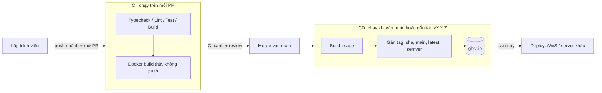

# Pipeline CI/CD và Docker

Tài liệu này giải thích pipeline hiện tại đang làm gì, từng bước vì sao có. Chưa tích hợp AWS: sản phẩm cuối là **Docker image trên GitHub Container Registry (ghcr.io)**.

## Hai khái niệm

- **CI (Continuous Integration):** mỗi lần có code mới, máy chủ tự kiểm tra (biên dịch, test, build). Lỗi thì chặn lại, không cho vào nhánh chính.
- **CD (Continuous Delivery/Deployment):** khi code đã vào nhánh chính, máy chủ tự đóng gói thành sản phẩm có thể chạy (ở đây là Docker image) và phát hành. Bước "triển khai lên server" sẽ thêm sau.

## Luồng tổng thể



## Các file liên quan

| File | Vai trò |
|---|---|
| `.github/workflows/frontend-ci.yml` | Kiểm tra frontend, rồi build thử Docker image |
| `.github/workflows/backend-ci.yml` | Kiểm tra backend, rồi build thử Docker image |
| `.github/workflows/cd.yml` | Build và đẩy image frontend + backend lên ghcr.io |
| `backend/Dockerfile`, `frontend/Dockerfile` | Công thức đóng gói từng phần |
| `frontend/nginx.conf` | Cấu hình web server phục vụ frontend |
| `docker-compose.yml` | Chạy cả hệ thống ở máy local bằng một lệnh |

## Dockerfile: vì sao viết như vậy

1. **Multi-stage build.** Giai đoạn 1 dùng image lớn có SDK/Node để biên dịch. Giai đoạn 2 chỉ copy kết quả sang image nhỏ để chạy. Image cuối nhỏ hơn, ít lỗ hổng hơn.
2. **Tách lớp cache.** Backend copy `.csproj` rồi `restore` trước khi copy code. Frontend copy `package.json` rồi `npm ci` trước. Sửa code mà không đổi thư viện thì Docker dùng lại cache, build nhanh hơn nhiều.
3. **Không chạy bằng root.** Backend chạy user `app`, frontend dùng `nginx-unprivileged`. Nếu bị tấn công thì quyền hạn thấp hơn.
4. **`.dockerignore`.** Không đưa `node_modules`, `bin`, `obj`, `.env` vào image: nhẹ hơn và không lộ bí mật.
5. **Biến `VITE_*` của frontend cố định lúc build.** Muốn đổi cấu hình phải build lại image. Đây là đặc điểm của Vite, không phải lỗi.

## Tag của image

`cd.yml` tự gắn nhiều tag cho cùng một image:

| Tag | Ý nghĩa |
|---|---|
| `sha-abc1234` | Đúng commit nào. Dùng để truy vết và rollback |
| `main` | Bản mới nhất của nhánh main |
| `latest` | Giống `main`, chỉ để thử nhanh. Không dùng cho production |
| `1.2.3` | Khi gắn tag git `v1.2.3`. Dùng cho release chính thức |

Phát hành bản chính thức:
```
git tag v0.1.0
git push origin v0.1.0
```

Image nằm ở `ghcr.io/sneakez/nexus-aws/frontend` và `.../backend` (tab **Packages** của repo). Lần đầu có thể cần vào Package settings để chỉnh quyền hiển thị.

## Chạy local

```
cp .env.example .env
docker compose up --build
```
Frontend: http://localhost:5174, Backend: http://localhost:5145/health

## Khi nào gắn AWS

Giữ nguyên toàn bộ phần trên. Chỉ thay/thêm:
1. Đăng nhập AWS bằng OIDC (không lưu access key trong secrets).
2. Đẩy image lên **ECR** thay vì (hoặc cùng với) ghcr.io.
3. Thêm job `deploy` cập nhật dịch vụ (App Runner/ECS), dùng **GitHub Environments** `staging` và `production` có bước duyệt tay.

## Việc nên làm tiếp

- Quét lỗ hổng image (Docker Scout hoặc Trivy) trước khi push. Ghim action bằng commit SHA.
- Bật branch protection và bắt buộc các check CI.
- Thêm test cho backend (hiện mới có một test health).
- Dọn lỗi lint rồi bỏ `continue-on-error`.
- Thêm Environments + bước duyệt tay trước khi deploy production.
