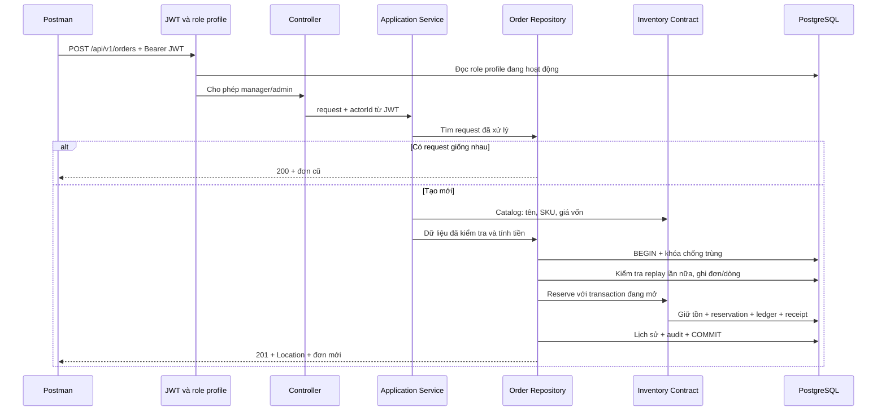
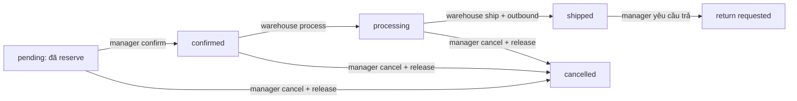

# Học lại phần tự làm ngày 3–4 — Dev 2

## 1. Đọc từ đâu và đang tới ngày nào?

Bạn đang làm backend .NET trong D:/noxus-aws/backend, bằng Visual Studio màu tím.
Mã mới tiếp tục trên nhánh codex/dev2-order-transitions.

Ngày 3 của Dev 2: tạo/hủy đơn qua IInventoryContract để Order và Inventory đồng bộ.
Đã bổ sung cả xuất kho và hai bước confirm/process để demo được chuỗi đầy đủ.
Ngày 4 của Dev 2 theo bản phân công: return requests/items và fee breakdown.
Tạo yêu cầu trả hàng chưa có nghĩa đã QC, nhập kho hay hoàn tiền. Những luồng đó
không được đánh dấu hoàn thành ở lần làm này. Webhook/HMAC là phần Dev 1.

Tài liệu này giải thích thay đổi như các bước chúng ta đã cùng viết, không yêu
cầu bạn tự hiểu cả project một lần. Chạy demo trước, sau đó đọc theo thứ tự bên dưới.

## 2. Bài toán nghiệp vụ trước khi nhìn code

Kho có 10 sản phẩm, một đơn đặt 2:

| Thời điểm | Physical stock | Reserved | Available |
|---|---:|---:|---:|
| Ban đầu | 10 | 0 | 10 |
| Tạo đơn + reserve | 10 | 2 | 8 |
| Nếu hủy | 10 | 0 | 10 |
| Nếu xuất thay vì hủy | 8 | 0 | 8 |

Reserve không trừ hàng thực tế. Hủy chỉ nhả lượng giữ của đúng đơn. Xuất kho giảm
cả hàng thực tế và lượng giữ. Không thể hủy cùng một lượng hàng sau khi đã xuất.

Nếu đơn có hai sản phẩm, sản phẩm thứ nhất còn hàng và sản phẩm thứ hai hết hàng,
không được để sản phẩm thứ nhất bị giữ lại trong một đơn tạo thất bại.

## 3. Luồng HTTP thật



Hai lần kiểm tra replay có mục đích khác nhau: lần đầu tránh đọc lại catalog cho
một request đã xong; lần trong transaction bảo vệ khi hai request mới đến đồng thời.

## 4. Bảng file và trách nhiệm

Các đường dẫn sau tính từ D:/noxus-aws/backend/.

| File/nhóm | Tầng | Công việc |
|---|---|---|
| src/NexusOMS.Api/Controllers/OrderCommandsController.cs | API | Route, role, actor từ JWT, mã HTTP |
| src/NexusOMS.Api/Infrastructure/OrderWorkflowExceptionFilter.cs | API | Chuyển lỗi nghiệp vụ sang 400/404/409 |
| src/NexusOMS.Api/Program.cs | Composition root | Đăng ký filter, ProblemDetails, middleware |
| Modules/OrderingAndFinance/Application/OrderCreationService.cs dưới src | Application | Chuẩn hóa, replay nhanh, gọi chuẩn bị/lưu |
| Application/OrderPreparationService.cs | Application | Catalog snapshot, tính dòng và tổng tiền |
| Application/OrderCancellationService.cs, OrderShippingService.cs | Application | Kiểm tra ID/người thực hiện, chuẩn hóa request |
| Application/OrderProgressService.cs | Application | Kiểm tra confirm/process và khóa |
| Domain/OrderTransitionRules.cs | Domain | Trạng thái được confirm/process/cancel/ship |
| Infrastructure/PostgresOrderCreationRepository.cs | Infrastructure | Transaction tạo đơn + reserve |
| Infrastructure/PostgresOrderCancellationRepository.cs | Infrastructure | Khóa đơn, release, cancelled, audit/receipt |
| Infrastructure/PostgresOrderShippingRepository.cs | Infrastructure | Khóa đơn, outbound, shipped, audit/receipt |
| Infrastructure/PostgresOrderProgressRepository.cs | Infrastructure | Confirm/process có transaction và replay |
| OrderingAndFinanceModuleExtensions.cs | Composition | Ghép interface với implementation và service |
| src/Modules/InventoryAndChannels/Infrastructure/PostgresInventoryContract.cs | Infrastructure Dev 1 | Thao tác tồn với context chung; thêm ngoại lệ legacy pending an toàn |
| tools/NexusOMS.ApiLab | Công cụ test riêng | HTTP thật qua API Program, JWT lab, PostgreSQL thật |

Ở các dòng viết tắt Application/Domain/Infrastructure phía trên, thư mục đầy đủ là
src/Modules/OrderingAndFinance/<tầng>/. Đọc Controller -> Service -> Repository,
không bắt đầu bằng toàn bộ SQL trong project.

## 5. DI: ai tạo các object?

API không dùng new PostgresOrderCreationRepository trong controller. DI được đăng
ký trong OrderingAndFinanceModuleExtensions:

```csharp
services.AddScoped<IOrderCreationRepository, PostgresOrderCreationRepository>();
services.AddScoped<OrderPreparationService>();
services.AddScoped<OrderCreationService>();
```

Khi controller cần OrderCreationService, DI tạo service, rồi lần theo constructor
để tìm repository và catalog. InventoryAndChannels đăng ký IInventoryContract và
IProductCatalogContract. Thiếu một đăng ký sẽ làm request không tạo được dependency.
AddScoped nghĩa là các dependency thuộc scope request; không phải mỗi sản phẩm
trong đơn có một scope hay một transaction riêng.

## 6. Transaction: object nào được truyền?

```csharp
await using var transaction = await connection.BeginTransactionAsync(ct);
var context = new InventoryTransactionContext(transaction);
await inventory.ReserveAsync(request, context, ct);
await transaction.CommitAsync(ct);
```

- connection là phiên kết nối database.
- transaction gom các thay đổi thành một đơn vị thành công/thất bại.
- context.Connection lấy từ chính transaction để không truyền nhầm connection.
- Inventory không tự commit; Order chỉ commit sau khi mọi bước xong.
- await using dispose transaction khi thoát scope. Nếu chưa commit, thay đổi rollback.
- Lỗi sau commit không quay ngược commit. Khóa chống trùng cho phép retry lấy lại đơn.

Lỗi một dòng hoặc lỗi audit không được bắt rồi bỏ qua để tiếp tục commit. Filter ở
API chỉ xử lý exception SAU KHI stack repository đã thoát và transaction dispose.

## 7. Khóa: chống trùng khác chống oversell

pg_advisory_xact_lock khóa theo mã request. Hai request cùng khóa phải đợi nhau.
Nhưng hai đơn KHÁC khóa vẫn có thể cùng tranh một sản phẩm.

Inventory dùng update có điều kiện stock - reserved >= quantity. Một đơn không đủ
hàng không cập nhật được dòng, báo lỗi, khiến transaction tạo đơn rollback.

Hủy và xuất dùng SELECT ... FOR UPDATE trên cùng dòng orders. Ví dụ cả hai đến
cùng lúc ở processing: bên thắng hoàn tất cancelled hoặc shipped; bên đợi đọc
trạng thái mới và bị từ chối. Hai thao tác không cùng tiêu thụ một lượng giữ.
Nhiều sản phẩm được xử lý theo ProductId thống nhất để giảm nguy cơ deadlock.

## 8. Idempotency không phải chỉ kiểm tra trùng mã đơn

| Trường hợp | Kết quả |
|---|---|
| Tạo: cùng khóa, cùng nội dung | 200 + đơn cũ, không reserve thêm |
| Tạo: cùng khóa, đổi nội dung | 409 |
| Mã đơn đã có, dùng khóa mới | 409 |
| Hủy/xuất/confirm/process: cùng khóa, cùng thao tác/nội dung | 200 + replayed=true |
| Khóa thao tác dùng cho đơn hoặc loại thao tác khác | 409 |
| Return: cùng Id, cùng nội dung | 200, không ghi thêm dòng/audit |
| Fee: cùng Id | 409 theo hợp đồng hiện tại, không ghi phí/audit lần hai |

Không bỏ phí vận chuyển hoặc lý do hủy khi đối chiếu nội dung. Giá vốn hiện tại
không dùng để đối chiếu request cũ: catalog thay đổi không được làm sai replay.

## 9. Trạng thái và quyền



Manager/admin tạo, xác nhận và hủy. Warehouse trở lên process/ship và đọc đơn/return.
Warehouse không được tạo return hoặc đọc/ghi fees/profit. Chi tiết đơn cho warehouse
trả unitCost=null. Token có claim app_role=admin giả vẫn không vượt được role thật
trong profile; trường hợp này được đưa vào lab test.

Shipped chưa phải delivered. Return request chưa phải refunded hay hàng đã nhập kho.
Không tự đánh dấu giao thành công hoặc hoàn tiền khi chưa có nghiệp vụ tương ứng.

## 10. Đơn cũ không có reservation

Đơn pending từ trước, creation_request NULL và chưa có BẤT KỲ lịch sử reservation
nào: hủy được, release là no-op và không tạo stock transaction giả.

Đơn mới có creation_request hoặc đơn đã có reservation nhưng không còn lượng giữ:
không được coi là legacy để bỏ qua lỗi. Outbound luôn đòi lượng giữ thực tế.
Đây là thay đổi trong Inventory mà Dev 1 cần biết khi pull nhánh.

## 11. Ngày 4: return và fee

ReturnService kiểm tra ID, lý do, 1..100 dòng, quantity dương/tối đa 3 số lẻ và không
lặp orderItemId. Repository khóa order và tính lượng còn được yêu cầu trả sau các
request chưa rejected. Hai request tranh lượng cuối: một thành công, một 409.
Header, items và audit chung transaction; audit lỗi thì không để header/items mồ côi.

OrderFeeService kiểm tra loại phí và số tiền; repository ghi fee và audit chung
transaction. GET fees cho đơn không tồn tại nay trả 404; đơn có thật/chưa phí trả [].
Chưa làm QC, nhập hàng trả hoặc refund. ReturnInbound của Inventory tồn tại nhưng
không được tự gọi từ POST /returns. Chưa tuyên bố luồng nhập trả đã nghiệm thu.

## 12. Tiền và giá vốn: phần nào đã quyết định?

Giữ tương thích code đã học: decimal, đơn giá/thuế/phí tối đa 2 chữ số thập phân;
line total làm tròn từng dòng bằng AwayFromZero đến 2 số rồi cộng subtotal. Không
âm thầm đổi sang nguyên VND trong lần này vì bạn chưa chốt thay đổi chính sách đó.
Đây là tính tiền nội bộ MVP, không phải xác nhận quy định thuế/hóa đơn/thanh toán.

UnitPrice là giá bán. UnitCost là snapshot cost_price từ catalog lúc chuẩn bị đơn.
Lợi nhuận hiện là ước tính, chưa trừ refund và chưa phải đủ báo cáo CM1-CM3 ngày 5.
Khi thiếu snapshot giá vốn của đơn cũ, estimate trả null thay vì giả sử vốn bằng 0.

## 13. Các kiểm tra thực sự đã chạy

- Bộ unit test hiện có: 66 case. Con số không bao gồm lab console/collection.
- Repository lab dùng Inventory thật: reserve/release/outbound, replay, rollback,
  8 cancel đồng thời, cancel-vs-ship và tranh tồn cuối.
- HTTP lab chạy API Program thật, DI thật, JWT bearer thật, profile role/database
  thật. Chỉ issuer/signing key được override trong executable test riêng.
- Trigger tạm cố tình làm audit thất bại cho create/cancel/ship/return/fee để chứng
  minh rollback, sau đó retry. Trigger được dọn trong finally.
- Postman CLI collection: 22 request, 31 assertion, local run, không publish cloud.
- CI được bổ sung PostgreSQL mới, bootstrap auth giả chỉ cho database lab mới, chạy
  mọi migration rồi cả hai lab. Không yêu cầu mật khẩu/tài khoản thật của nhóm.

JWT ký riêng chỉ sống trong lab, không được API bình thường chấp nhận. Kiểm tra
này không gọi Supabase login/JWKS thật, không phải kiểm tra frontend hoặc sàn thật.

## 14. Cách chạy lại, tách rõ nơi nhập

TRONG POWERSHELL tại D:/noxus-aws:

```powershell
dotnet test backend/NexusOMS.slnx
dotnet run --project backend/tools/NexusOMS.OrderCreationLab/NexusOMS.OrderCreationLab.csproj
dotnet run --project backend/tools/NexusOMS.ApiLab/NexusOMS.ApiLab.csproj -- --postman
```

Docker lab phải đang chạy và có các migration. Đừng dán C# hoặc SQL trần vào dấu
nhắc PS>. C# sửa trong tab file Visual Studio; SQL lưu trong .sql rồi chạy qua psql
hoặc SQL Editor. Lab không tự sửa database Supabase chung.

Nếu DLL bị khóa: Ctrl+C trong terminal API đang chạy rồi build lại. Shift+F5 chỉ
dừng API do Visual Studio chạy, không dừng dotnet run ở terminal khác.

## 15. Bài thực hành lại cho bạn

1. Không nhìn code, viết giả mã tạo đơn: role -> validate -> replay -> catalog ->
   transaction -> lock/replay -> order/items -> reserve -> history/audit -> commit.
2. Giải thích vì sao warehouse token có claim admin vẫn nhận 403 khi tạo đơn.
3. Tự viết lại CancelOrderValidator, sau đó chạy test của validator.
4. Đổi tạm một điều kiện CanShip trong nhánh học, chạy test để thấy case nào bảo vệ.
5. Đọc SaveShipmentAsync và chỉ ra bốn chỗ ghi dữ liệu; chỉ ra stock được ghi ở đâu.
6. Chạy audit-failure lab, chứng minh vì sao không được bắt lỗi rồi vẫn commit.
7. Giải thích khác nhau giữa 200 replay, 201 mới, 400, 401, 403, 404 và 409.

Bạn chưa tự thực hành các bước này thì ghi là chưa luyện lại, không coi test máy
chạy pass là bạn đã hiểu. Phần deploy/demo không bị chặn bởi bài tập học này.

## 16. Việc còn lại sau lần làm

- Merge PR sau khi CI GitHub xanh; database chung cần migrations chưa áp dụng.
- Kiểm tra bằng JWT Supabase thật của nhóm trên API bình thường khi bạn quay lại.
- Chốt chính sách tiền trước sử dụng kế toán/thanh toán thực tế.
- Phối hợp webhook/HMAC của Dev 1 để đạt tiêu chí chung ngày 4.
- Ngày 5: CM1-CM3/journal/audit tài chính. Ngày 6: frontend thật. Ngày 7: triển khai.
