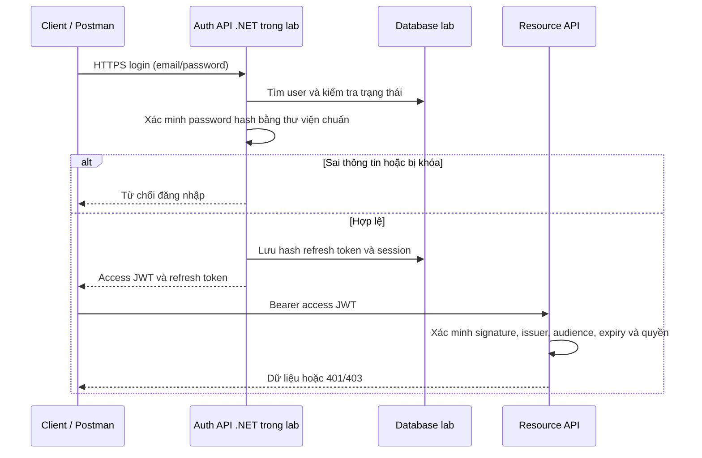

# Lab sau dự án: tự xây authentication và cấp JWT bằng .NET

Trạng thái: chưa học thực hành, chưa triển khai. Làm sau khi hoàn thành NexusOMS; không thay Supabase Auth trong sản phẩm hiện tại. Không có lịch nhắc tự động.

## Mục tiêu

Hiểu và tự triển khai luồng đăng nhập, cấp access token, refresh, đăng xuất và kiểm tra quyền. JWT là định dạng token; tự cấp JWT không đồng nghĩa đã xây OAuth/OIDC provider.

## Bản hiện tại để đối chiếu

Supabase Auth kiểm tra thông tin đăng nhập và cấp token. Postman gửi Bearer access token. API .NET xác minh token; ProfileClaimsTransformation gọi IProfileRoleReader để lấy role của profile đang hoạt động. Controller áp dụng policy. Frontend React chưa được xác nhận đã nối luồng thật.

Sơ đồ trên là mục tiêu lab, chưa có implementation. Không dùng tài khoản, khóa ký hoặc dữ liệu production.

## Các chặng thực hành

1. Tạo project/nhánh lab riêng, database test và threat model ngắn. Dùng ASP.NET Core Identity hoặc thư viện quản lý mật khẩu chuẩn; không tự chế thuật toán hash.
2. Làm login, kiểm tra user active/lockout, thông báo lỗi không tiết lộ tài khoản; rate limiting và log không chứa mật khẩu/token.
3. Cấp JWT có sub, iss, aud, iat, exp, jti phù hợp; quản lý khóa ngoài Git. Resource API xác minh đầy đủ, không chỉ decode payload. Thử sửa payload để thấy signature bị từ chối.
4. Sinh refresh token ngẫu nhiên bằng bộ sinh mật mã, chỉ lưu hash ở server. Rotation, thời hạn, revoke session và phát hiện reuse; test hai request refresh đồng thời.
5. Logout thu hồi refresh session. Giải thích rõ access JWT cũ có thể còn hạn; chọn chính sách thu hồi access phù hợp thay vì hứa logout làm token mất hiệu lực ngay.
6. Nối client: lựa chọn nơi lưu token/cookie có đánh đổi XSS/CSRF; phân biệt CORS và authorization. Không lưu token trong URL/log/Git.
7. Quản lý thay đổi role và khóa tài khoản; phân biệt role trong JWT có thể cũ với đọc quyền từ database như NexusOMS.
8. Lab riêng về OAuth 2.0 Authorization Code + PKCE và OIDC bằng provider/library có sẵn. Không coi password login hiện tại là bằng chứng đã thực hành OAuth redirect flow; không tự viết authorization server chỉ để cấp JWT.

## Kiểm thử cần có

Login đúng/sai; tài khoản bị khóa; token thiếu, hết hạn, sửa nội dung, sai issuer/audience/key; 401 so với 403; refresh hợp lệ/hết hạn/replay/đồng thời; logout; role thay đổi; truy cập đối tượng của người khác khi có ownership; kiểm tra secret/PII trong log. Số đo hiệu năng chỉ ghi khi đã đo và có điều kiện đo.

## Cách học theo tài liệu hợp nhất

Hoàn thành và kiểm chứng từng chặng, vẽ luồng thật và bảng ánh xạ file/class/hàm, rồi luyện lại trên bản riêng. Khung được cấp gồm project và test fixture; người học tự viết từng hàm vừa sức, được hỏi syntax ngay. Không xóa bản đã chạy của NexusOMS. Gây lỗi chỉ trong lab, ghi dự đoán, quan sát và cách khôi phục. Review .NET, SQL, security; queue/cache không áp dụng nếu lab không dùng.

Chủ đề: C# async/await và IDisposable; ASP.NET Core DI/middleware; SQL/session transaction; Web API/JWT; xUnit; security OAuth/OIDC/hash/signature; cấu hình secret và logging. Ôn lại lõi sau 3–7 ngày kể từ buổi làm lab, kèm một biến thể.

Ba câu tự kiểm tra (chưa đưa đáp án):
1. Đoạn cấp token, xác minh token và kiểm tra quyền nằm ở đâu trong lab?
2. Tôi tự viết lại được phần nào khi đóng mẫu, còn cần trợ giúp gì?
3. Mỗi bước bảo vệ điều gì; bỏ bước đó thì lỗi hoặc lỗ hổng nào xuất hiện?

Nhật ký cần ghi: ngày, commit, kết quả test, sơ đồ/bảng ánh xạ, phần tự viết, lỗi chủ động gây, mức trợ giúp, biến thể và lịch ôn. Chỉ đánh dấu thành thạo khi có bằng chứng tự làm và debug được.
